# Do Sudden Changes in Demand Matter? Forecasting and Stock Planning with Walmart Data

[](../../actions/workflows/tests.yml)

Shops need to guess how much of each product they will sell, so they can keep enough on the shelf without
wasting money on extra stock. Sometimes a product's sales suddenly change for good: it becomes more popular,
a competitor appears, or the price changes. This project asks three simple questions:

1. **Do these lasting changes in sales really happen, and can we spot them?**
2. **If we update the forecast after spotting one, do the forecasts get better?**
3. **What does all this mean for how much stock a shop should keep?**

The data is Walmart's public M5 dataset: daily sales of every product in its California stores from 2011 to 2016.
The results were then checked again on Texas and Wisconsin stores.

## What we found

Every number in this section is filled in automatically from the results file (`outputs/results_facts.json`).
A test fails if the text and the results ever disagree.

<!-- KEY-RESULTS:START (generated by scripts/update_readme.py; do not edit) -->
### In plain words

1. **Do sales levels really change? Yes, often.** After removing changes that would appear just by chance, about **63%** of the busy items changed their normal sales level at some point. Our change detector only notices big changes, though: a sudden 20% jump is spotted just 18% of the time.
2. **Which forecast works best? LightGBM.** Its typical error is **24% smaller** than simply copying last week's sales. It guesses a little low overall (3.6% under).
3. **Does retraining the model after a change help? No.** We tried 4 different ways. None made forecasts better, and the simplest one made them slightly worse. The same was true in Texas and Wisconsin.
4. **Does a better forecast save money on stock? Yes.** Using the better forecast to decide when to reorder means holding **17% less stock** at **10% lower cost** than the simple method, and it was clearly cheaper in 3 of 3 time periods tested. Setting safety stock from realistic error ranges cut the cost by a further **31%**. These costs use assumed prices for storage and lost sales, not real Walmart figures.

### Milestone 2: classical time-series models

On a sample of 150 items, with the same backtest as above: **17%** of the 726 items test as stationary (ADF and KPSS agree). SARIMA (median MASE 0.755) and Holt-Winters (0.757) against seasonal naive (0.973): SARIMA better: **Yes** (median difference -0.223, 95% CI -0.237 to -0.200); Holt-Winters better: **Yes** (-0.218, 95% CI -0.233 to -0.207). The lowest median error is **LightGBM** (0.747). Reacting to a detected break helps SARIMA: **No** (restart +0.0000, level-shift dummy +0.0000 MASE, n = 75 items). Details: `docs/midsem/INTERIM_FINDINGS.md`.

<details><summary><b>Technical details</b> (verdicts, confidence intervals, test statistics)</summary>

| Question | Verdict | Evidence | Caveat |
|---|---|---|---|
| Do demand shifts exist, and can we detect them? | **Partly** (strong) | An estimated 63.5% of items have a real shift (95% CI 59.8% to 67.2%), after removing chance alarms. | The detector is coarse: a sudden 20% shift is caught only 18% of the time. |
| Which forecast is best? | **LightGBM** (moderate) | LightGBM: median error 0.744 vs 0.976 for the simple baseline (MASE; lower is better). | It under-forecasts by 3.6% in total. |
| Does retraining after a shift help? | **No** (strong) | None of 4 retraining methods improved forecasts. Simply restarting from the shift made error slightly worse (+0.0033 MASE, n = 488 items), and the same holds in 2 other states. | Tested with one model (LightGBM) and four simple methods; small shifts are invisible to the detector. |
| Does a better forecast cut stock cost? | **Yes** (strong) | At a 95% target, LightGBM-based reorder points hold 16.6% less stock at 10.1% lower cost than the simple baseline; clearly lower in 3 of 3 time windows. | Lead time and costs are assumptions, not measured data. |

- **Scope:** 726 high-volume (AX/AY) California items, 23.8% of 3,049 items and 66.4% of units sold.
- **Shift detection:** 67.8% of the 718 items with two or more years of data are flagged. The false-alarm rate on a seasonality-preserving null is 11.9%, so the chance-adjusted share with a real shift is 63.5% (95% CI 59.8% to 67.2%). Only 171 of 488 breaks are high-confidence.
- **Forecasting:** median MASE is 0.744 for LightGBM, 0.755 for ETS and 0.976 for seasonal naive. LightGBM − ETS is -0.0091 (95% CI -0.0115 to -0.0066). Calibrated 90% bands cover 89.9% of days (was 85.5%).
- **Retraining after a shift:** restarting from the shift changes MASE by +0.0033 (95% CI +0.0015 to +0.0053, n = 488). None of the 4 methods tested helps.
- **Inventory (95% target, 7-day lead time, assumed costs):** static LightGBM holds 16.6% less inventory at 10.1% lower cost than seasonal naive. Calibrated safety stock changes total cost by -31.1%.
- **Replication:** 14 of 14 conclusion checks hold in TX and WI.

</details>
<!-- KEY-RESULTS:END -->

**The short version:** sales changes are real and common, but reacting to them by retraining the forecast does
not help. What does help is a better forecasting model and setting safety stock from realistic error ranges.

## The dashboard

An interactive website lets you explore all the results. It has thirteen pages (ten for Milestone 1, three for the Milestone 2 classical models), each answering one question in plain
words, with charts that say what they show and how to read them. The pictures below switch between light and dark
to match your GitHub theme.

| Overview: the four answers | Data and method |
|---|---|
| <picture><source media="(prefers-color-scheme: dark)" srcset="docs/screenshots/dark/overview.png"></picture> | <picture><source media="(prefers-color-scheme: dark)" srcset="docs/screenshots/dark/data_method.png">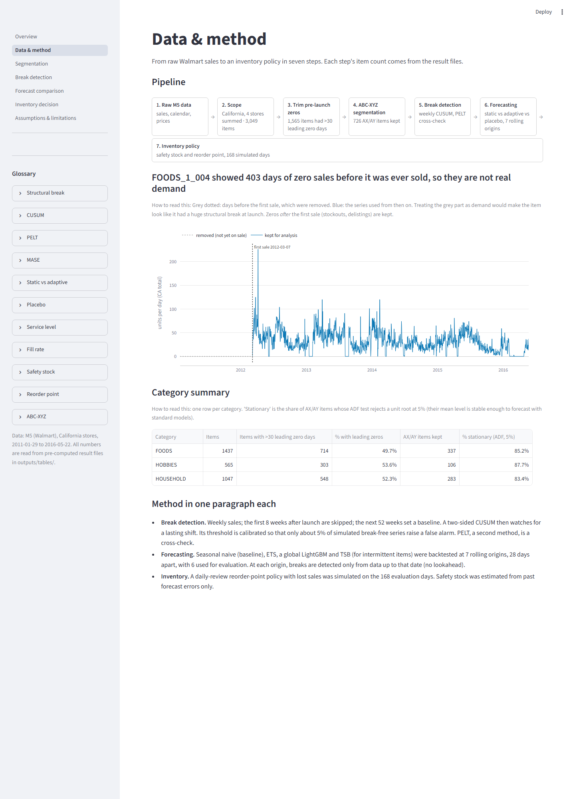</picture> |
| **Which products were studied** | **Spotting changes in sales** |
| <picture><source media="(prefers-color-scheme: dark)" srcset="docs/screenshots/dark/segmentation.png">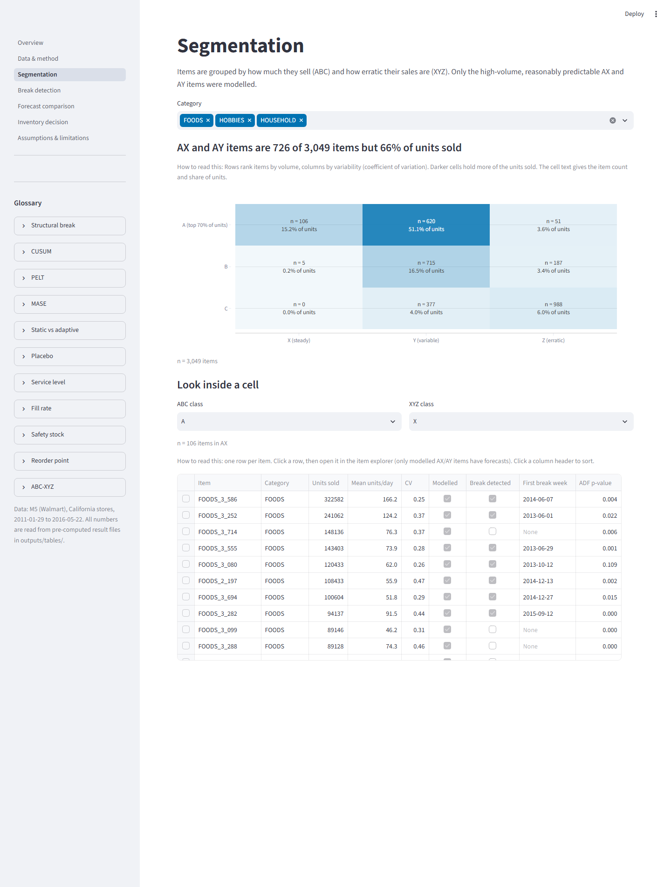</picture> | <picture><source media="(prefers-color-scheme: dark)" srcset="docs/screenshots/dark/breaks.png">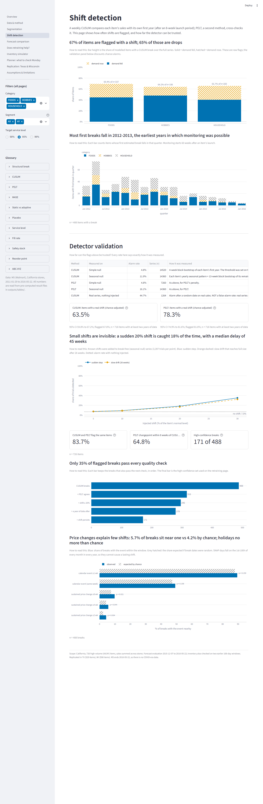</picture> |
| **Which forecast works best** | **Does retraining help?** |
| <picture><source media="(prefers-color-scheme: dark)" srcset="docs/screenshots/dark/forecasts.png">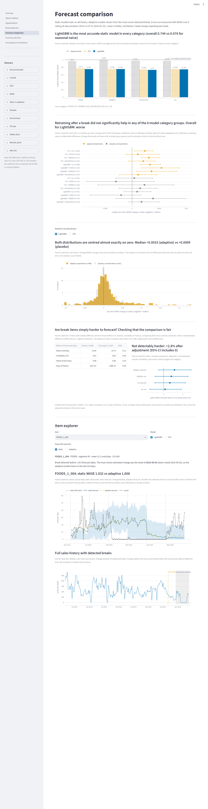</picture> | <picture><source media="(prefers-color-scheme: dark)" srcset="docs/screenshots/dark/retraining.png">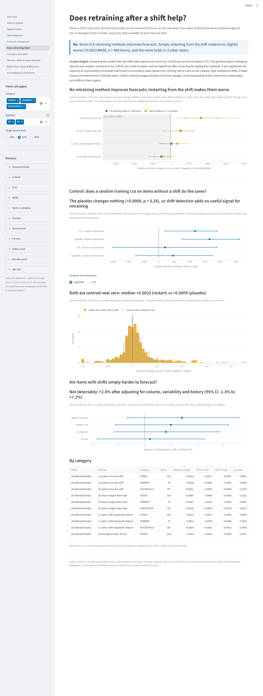</picture> |
| **Inventory simulator** | **Planner: what to check on Monday** |
| <picture><source media="(prefers-color-scheme: dark)" srcset="docs/screenshots/dark/inventory.png">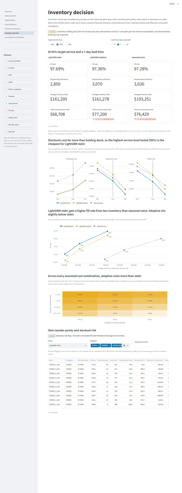</picture> | <picture><source media="(prefers-color-scheme: dark)" srcset="docs/screenshots/dark/planner.png">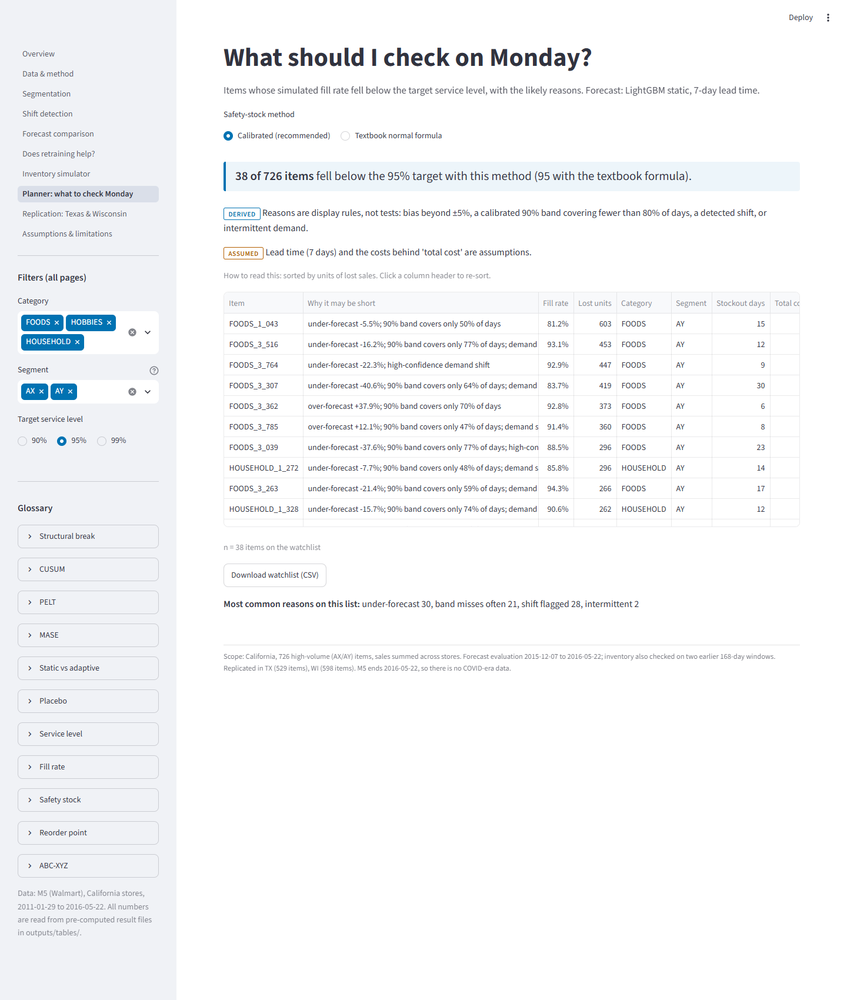</picture> |
| **Texas and Wisconsin** | **Assumptions and limits** |
| <picture><source media="(prefers-color-scheme: dark)" srcset="docs/screenshots/dark/replication.png">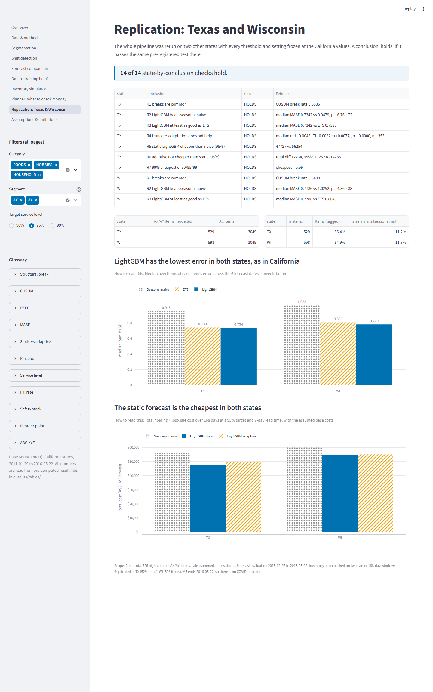</picture> | <picture><source media="(prefers-color-scheme: dark)" srcset="docs/screenshots/dark/limitations.png">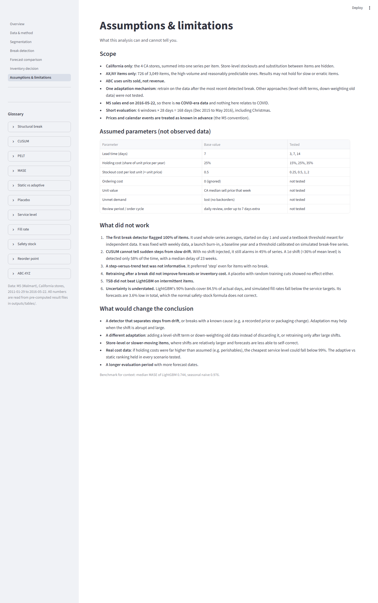</picture> |
| **Milestone 2: stationarity and decomposition** | **Milestone 2: classical models** |
| <picture><source media="(prefers-color-scheme: dark)" srcset="docs/screenshots/dark/stationarity.png">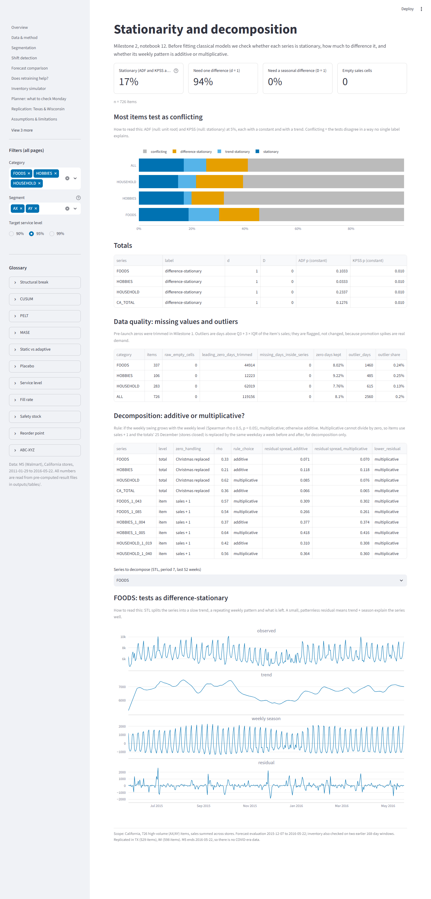</picture> | <picture><source media="(prefers-color-scheme: dark)" srcset="docs/screenshots/dark/classical.png">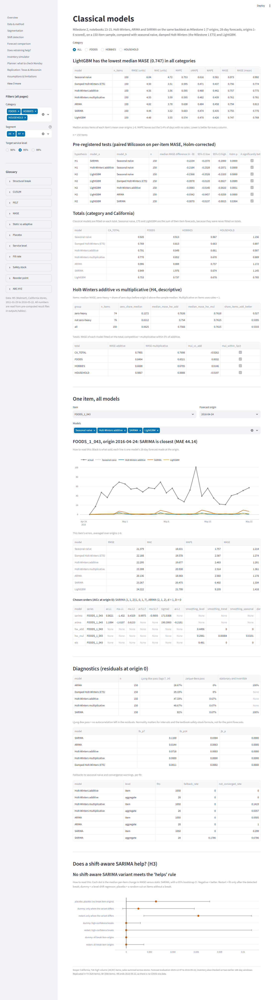</picture> |
| **Milestone 2: mid-sem demo walkthrough** | |
| <picture><source media="(prefers-color-scheme: dark)" srcset="docs/screenshots/dark/demo.png">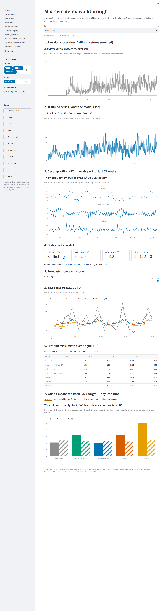</picture> | |

### Run it yourself
```bash
pip install -r dashboard/requirements.txt
streamlit run dashboard/app.py
```
Then open http://localhost:8501 in your browser. If the online version is asleep, a one-page summary is in
[docs/results_summary.pdf](docs/results_summary.pdf). Setup and hosting details are in
[docs/DASHBOARD.md](docs/DASHBOARD.md).

## How it works, step by step

1. **Pick the products.** Add up each product's sales across the stores. Remove the empty days before a product was
   first sold, and keep the products that sell a lot and fairly steadily.
2. **Look for lasting changes.** Compare each product's weekly sales with its own first year, and flag when they
   move away and stay away. A second method double-checks. The detector was also tested on made-up sales where we
   knew the right answer.
3. **Forecast.** Try four forecasting methods, from "copy last week" to a machine-learning model (LightGBM). Each is
   tested the honest way: it only sees the past when it makes a forecast.
4. **Update or not.** Try four ways of retraining the model after a change, plus a "fake change" control, to see if
   any of them helps.
5. **Plan the stock.** Simulate a shop reordering every day for half a year, and count how often it runs out, how
   much stock it holds and what that costs.
6. **Check again elsewhere.** Repeat everything on Texas and Wisconsin with the same settings.

These checks were written down before they were run ([docs/PREREGISTRATION.md](docs/PREREGISTRATION.md)), so the
rules could not be bent to fit the results. Every run, including one that failed, is logged in
[docs/RUN_LOG.md](docs/RUN_LOG.md), and the full results are in [docs/RESULTS.md](docs/RESULTS.md).

## Honest limits

- **Big sellers only:** only the high-volume products were studied, with sales added up across stores, so
  store-level stock-outs are hidden.
- **A coarse detector:** small changes in sales go unnoticed.
- **One model family:** only LightGBM, with four simple ways of retraining, was tried.
- **Assumed costs:** delivery time, storage cost and the cost of a lost sale are assumptions, not real Walmart
  figures. The dashboard marks them clearly.
- **Pre-COVID data:** the data ends in 2016, so it says nothing about COVID-era shopping.

The first version of this analysis, including what did not work along the way, is in
[docs/ORIGINAL_ANALYSIS.md](docs/ORIGINAL_ANALYSIS.md).

## Reproduce everything
```bash
pip install -r requirements.txt   # exact package versions
# download the M5 data into data/raw/ (see docs/DATA.md)
make all                          # runs every notebook, rebuilds the results file, runs the tests
python scripts/run_all.py         # the same on Windows without make (--m2 for notebooks 12-16 only)
python scripts/update_readme.py   # refreshes "What we found"
```

## What is in the repository
```
notebooks/   the analysis, step by step (00-11 Milestone 1; 12-16 Milestone 2 classical models; see docs/ROADMAP.md)
src/         reusable code: finding changes, forecasting, stock simulation
dashboard/   the interactive website
scripts/     build the results file, README numbers, screenshots and PDF summary
tests/       automatic checks for the code, the dashboard and the README numbers
outputs/     result tables, charts and results_facts.json
docs/        roadmap, results, pre-registrations, run log, data download, dashboard guide, demo script, midsem/ (Milestone 2)
powerbi/     notes for building a Power BI version
```
