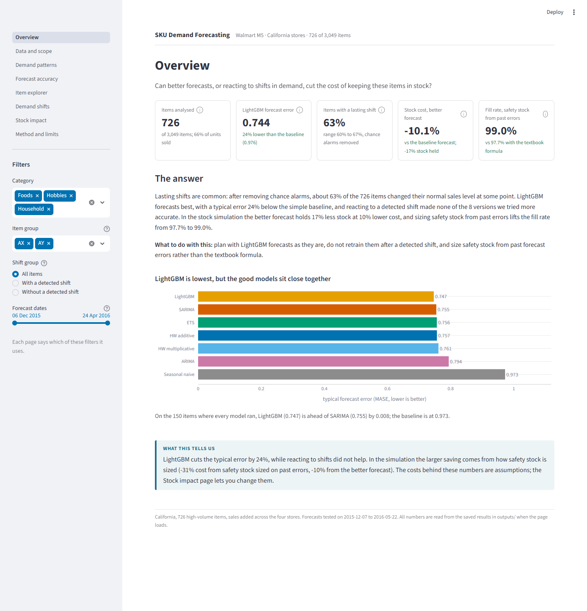
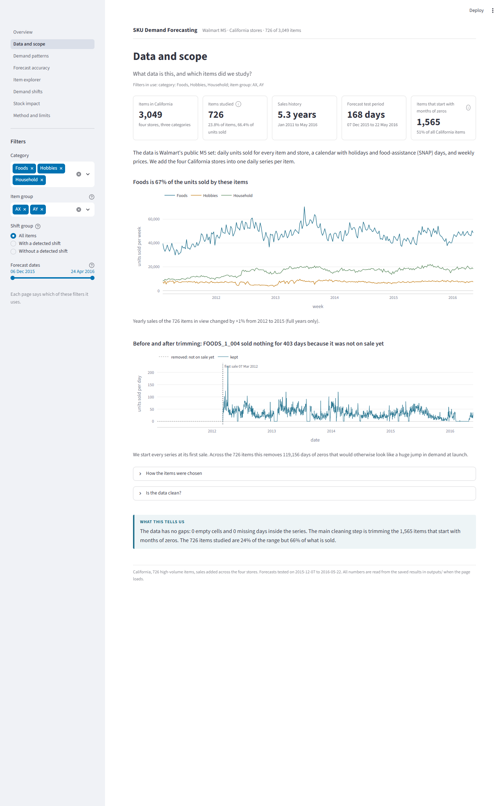
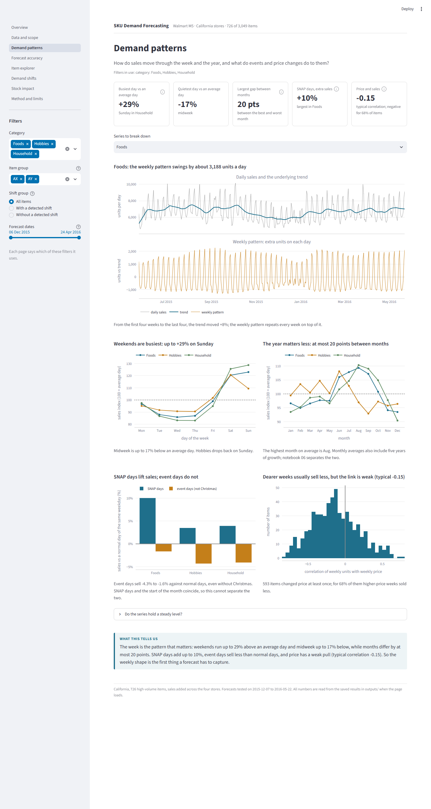
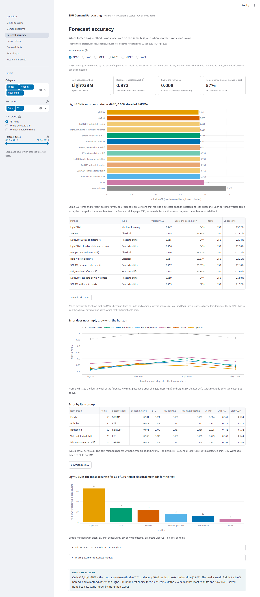
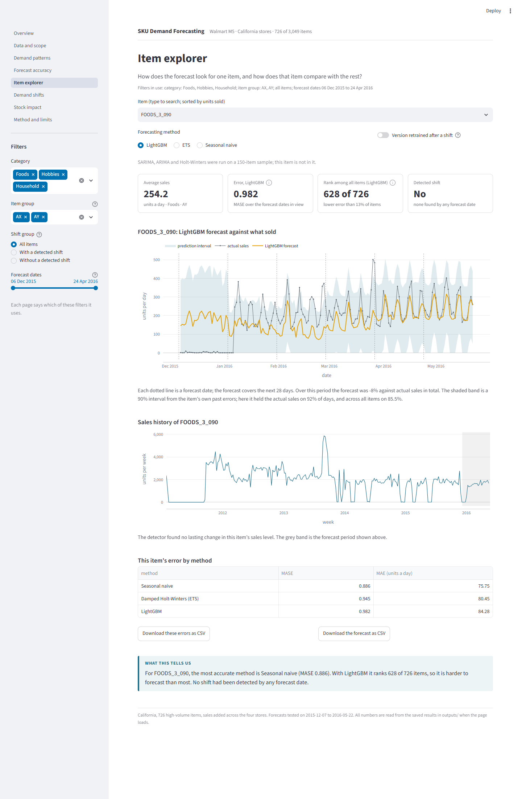
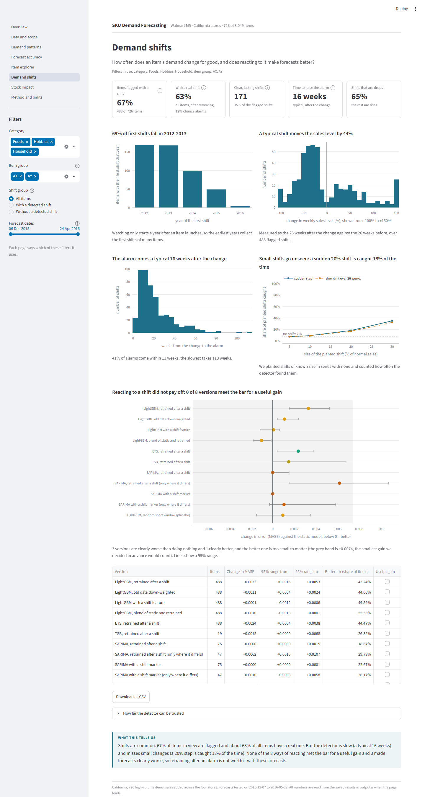
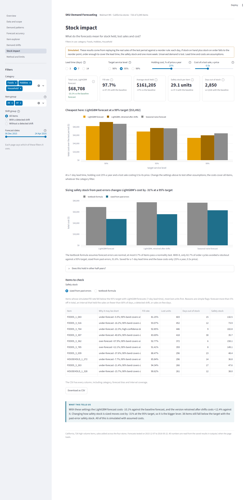
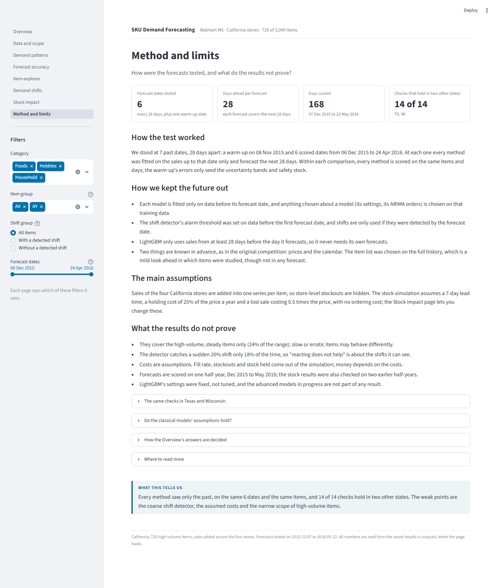

# Do Sudden Changes in Demand Matter? Forecasting and Stock Planning with Walmart Data

[](../../actions/workflows/tests.yml)

A shop has to guess how much of each product it will sell, so it keeps enough on the shelf without paying for stock
that sits there. Sometimes a product's sales change for good: it gets more popular, a competitor turns up, the price
moves. We wanted to know three things. Do these lasting changes really happen, and can we spot them? If we update
the forecast after spotting one, does it get better? And what does it all mean for how much stock to keep?

We use Walmart's public M5 data: daily sales of every product in its California stores from 2011 to 2016. We model
the 726 products that sell a lot and fairly steadily, and check the main results again on Texas and Wisconsin.

<!-- KEY-RESULTS:START (generated by scripts/update_readme.py; do not edit) -->
### What we found

1. Do sales levels really change? Yes, often. After removing changes that would appear just by chance, about 63% of the busy products changed their normal sales level at some point. Our change detector only notices big changes, though: a sudden 20% jump is spotted just 18% of the time.
2. Which forecast works best? LightGBM. Its typical error is 24% smaller than simply copying last week's sales. It guesses a little low overall (3.6% under).
3. Does retraining the model after a change help? No. We tried 4 different ways. None made forecasts better, and the simplest one made them slightly worse. The same was true in Texas and Wisconsin.
4. Does a better forecast save money on stock? Yes. Using the better forecast to decide when to reorder means holding 17% less stock at 10% lower cost than the simple method, and it was clearly cheaper in 3 of 3 time periods tested. Setting safety stock from realistic error ranges cut the cost by a further 31%. These costs use assumed prices for storage and lost sales, not real Walmart figures.

### Classical time-series models

On a sample of 150 products, with the same backtest as above: 17% of the 726 products test as stationary (ADF and KPSS agree). SARIMA (median MASE 0.755) and Holt-Winters (0.757) against seasonal naive (0.973): SARIMA better: Yes (median difference -0.223, 95% CI -0.237 to -0.200); Holt-Winters better: Yes (-0.218, 95% CI -0.233 to -0.207). The lowest median error is LightGBM (0.747). Reacting to a detected break helps SARIMA: No (restart +0.0000, level-shift dummy +0.0000 MASE, n = 75 products). Details: `notebooks/10_model_comparison.ipynb`.

<details><summary>Technical details (verdicts, confidence intervals, test statistics)</summary>

| Question | Verdict | Evidence | Caveat |
|---|---|---|---|
| Do demand shifts exist, and can we detect them? | Partly (strong) | An estimated 63.5% of items have a real shift (95% CI 59.8% to 67.2%), after removing chance alarms. | The detector is coarse: a sudden 20% shift is caught only 18% of the time. |
| Which forecast is best? | LightGBM (moderate) | LightGBM: median error 0.744 vs 0.976 for the simple baseline (MASE; lower is better). | It under-forecasts by 3.6% in total. |
| Does retraining after a shift help? | No (strong) | None of 4 retraining methods improved forecasts. Simply restarting from the shift made error slightly worse (+0.0033 MASE, n = 488 items), and the same holds in 2 other states. | Tested with one model (LightGBM) and four simple methods; small shifts are invisible to the detector. |
| Does a better forecast cut stock cost? | Yes (strong) | At a 95% target, LightGBM-based reorder points hold 16.6% less stock at 10.1% lower cost than the simple baseline; clearly lower in 3 of 3 time windows. | Lead time and costs are assumptions, not measured data. |

- Scope: 726 high-volume (AX/AY) California products, 23.8% of 3,049 products and 66.4% of units sold.
- Shift detection: 67.8% of the 718 products with two or more years of data are flagged. The false-alarm rate on a seasonality-preserving null is 11.9%, so the chance-adjusted share with a real shift is 63.5% (95% CI 59.8% to 67.2%). Only 171 of 488 breaks are high-confidence.
- Forecasting: median MASE is 0.744 for LightGBM, 0.755 for ETS and 0.976 for seasonal naive. LightGBM − ETS is -0.0091 (95% CI -0.0115 to -0.0066). Calibrated 90% bands cover 89.9% of days (was 85.5%).
- Retraining after a shift: restarting from the shift changes MASE by +0.0033 (95% CI +0.0015 to +0.0053, n = 488). None of the 4 methods tested helps.
- Inventory (95% target, 7-day lead time, assumed costs): static LightGBM holds 16.6% less inventory at 10.1% lower cost than seasonal naive. Calibrated safety stock changes total cost by -31.1%.
- Replication: 14 of 14 conclusion checks hold in TX and WI.

</details>
<!-- KEY-RESULTS:END -->

In short: lasting changes in sales are real and common, but reacting to them does not help, for the machine-learning
model or for the classical ones. What helps is a good forecast that is kept as it is, and safety stock sized from the
real spread of forecast errors rather than a textbook formula.

## The path through the work

The notebooks are numbered in the order you would learn the data, and each one starts by saying what question it
answers and what it hands on to the next.

| Stage | Notebook | What it does |
|---|---|---|
| 1 Meet the data | `01_meet_the_data` | the three files, their columns and size |
| 2 Choose scope | `02_scope` | California, 3,049 products, the 726 AX/AY products we keep, and why |
| 3 Explore | `03_explore` | statistics, histograms, weekly and yearly patterns, price, SNAP days and events, data quality |
| 4 Zeros at the start | `04_zeros_and_trimming` | the months of zeros before a product's first sale, and one product decomposed before and after trimming |
| 5 Stationarity | `05_stationarity` | ADF and KPSS, differencing, what it means for the models |
| 6 Decomposition | `06_decomposition` | the weekly pattern, then the yearly one |
| 7 Classical forecasting | `07a_classical_forecasting`, `07b_classical_residuals` | seasonal naive, Holt-Winters and ETS, ARIMA, SARIMA, TSB on a rolling backtest; residual checks |
| 8 Structural breaks | `08a` to `08d` | CUSUM and PELT, how far the detector can be trusted, and classical models that react to a break |
| 9 Machine learning | `09a_lightgbm`, `09b_lightgbm_after_breaks` | LightGBM on the same backtest, and four ways of retraining it after a break |
| 10 Comparison | `10_model_comparison` | every model in one table, and where the simple ones win |
| 11 Uncertainty and stock | `11a` to `11f` | honest error bands, a stock simulation, other seasons, Texas and Wisconsin |
| 12 Advanced models | `12_advanced_models_wip` | XGBoost, Prophet and a small GRU on 30 products; work in progress, not a result |

`90_powerbi_export` and `91_dashboard_export` only package the results. `docs/ROADMAP.md` lists what is done and what
is left.

## The dashboard

The dashboard is written for a retail planning manager with five minutes. It has eight pages: an Overview with the
answer on one screen, then Data and scope, Demand patterns, Forecast accuracy, an Item explorer for looking up one
item, Demand shifts, Stock impact (with controls for the cost assumptions) and Method and limits. Every number and
every sentence that states a result is computed from the saved outputs when the page loads. The filters in the
sidebar (category, item group, shift group, forecast dates) keep their values from page to page. The pictures switch
between light and dark with your GitHub theme.

| Overview | Data and scope |
|---|---|
| <picture><source media="(prefers-color-scheme: dark)" srcset="docs/screenshots/dark/overview.png"></picture> | <picture><source media="(prefers-color-scheme: dark)" srcset="docs/screenshots/dark/data_scope.png"></picture> |
| Demand patterns | Forecast accuracy |
| <picture><source media="(prefers-color-scheme: dark)" srcset="docs/screenshots/dark/demand_patterns.png"></picture> | <picture><source media="(prefers-color-scheme: dark)" srcset="docs/screenshots/dark/accuracy.png"></picture> |
| Item explorer | Demand shifts |
| <picture><source media="(prefers-color-scheme: dark)" srcset="docs/screenshots/dark/item_explorer.png"></picture> | <picture><source media="(prefers-color-scheme: dark)" srcset="docs/screenshots/dark/demand_shifts.png"></picture> |
| Stock impact | Method and limits |
| <picture><source media="(prefers-color-scheme: dark)" srcset="docs/screenshots/dark/stock_impact.png"></picture> | <picture><source media="(prefers-color-scheme: dark)" srcset="docs/screenshots/dark/method_limits.png"></picture> |

To run it, from the project folder with the environment active:
```bash
pip install -r dashboard/requirements.txt      # first time only
python -m streamlit run dashboard/app.py
```
Then open http://localhost:8501 (add `--server.port 8502` if that port is busy) and stop it with Ctrl + C. The
dashboard only reads `outputs/`, so it needs no data download; rerun the notebooks first if you change a result.
`docs/DASHBOARD.md` has the page guide and hosting notes, and `docs/DASHBOARD_MAP.md` shows where each earlier page
went.

## Run everything again
```bash
pip install -r requirements.txt     # exact package versions
# download the M5 data into data/raw/ (see docs/DATA.md)
python scripts/run_all.py           # every notebook in order, the results file, the README numbers, the tests
python scripts/run_all.py --from 07a_classical_forecasting    # or start from one notebook
```
`make all` does the same where `make` is installed.

## How we kept it honest

Every forecast only sees data up to the day it is made. The tests and decision rules were written down before the
results ([docs/PREREGISTRATION.md](docs/PREREGISTRATION.md) and
[docs/PREREGISTRATION_CLASSICAL.md](docs/PREREGISTRATION_CLASSICAL.md)), every run is in
[docs/RUN_LOG.md](docs/RUN_LOG.md), including the ones that failed, and every number in this README and on the
dashboard is read from `outputs/results_facts.json`. Why each model is there and how it is set up is in
[docs/MODEL_CHOICES.md](docs/MODEL_CHOICES.md); the full results are in [docs/RESULTS.md](docs/RESULTS.md).

## Limits

We only studied high-volume products, with sales added up over the stores, so stockouts in a single store are
hidden. The break detector misses small changes. The costs of storage and of a lost sale are our assumptions, not
Walmart's figures, and the dashboard marks every result that depends on them. The data ends in 2016, so it says
nothing about shopping after COVID.

## What is in the repository
```
notebooks/   the analysis, in learning order (see the table above)
src/         shared code: break detection, forecasting, metrics, the stock simulation
dashboard/   the interactive website
scripts/     run everything, build the results file and README numbers, take screenshots
tests/       checks for the code, the results, the dashboard and the docs
outputs/     result tables, figures and results_facts.json
docs/        roadmap, results, model choices, pre-registrations, run log, data download, dashboard guide
powerbi/     notes for building a Power BI version
```
