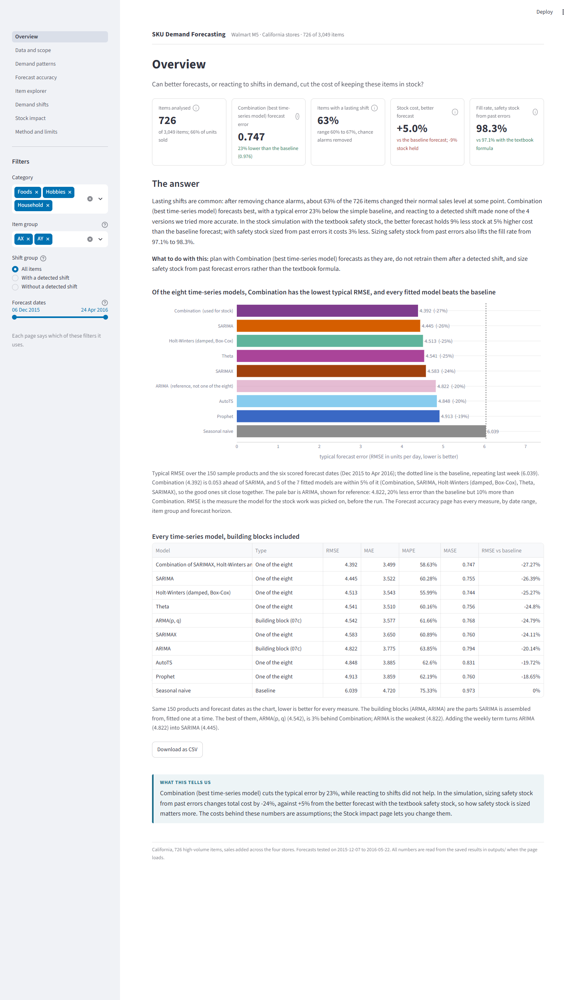
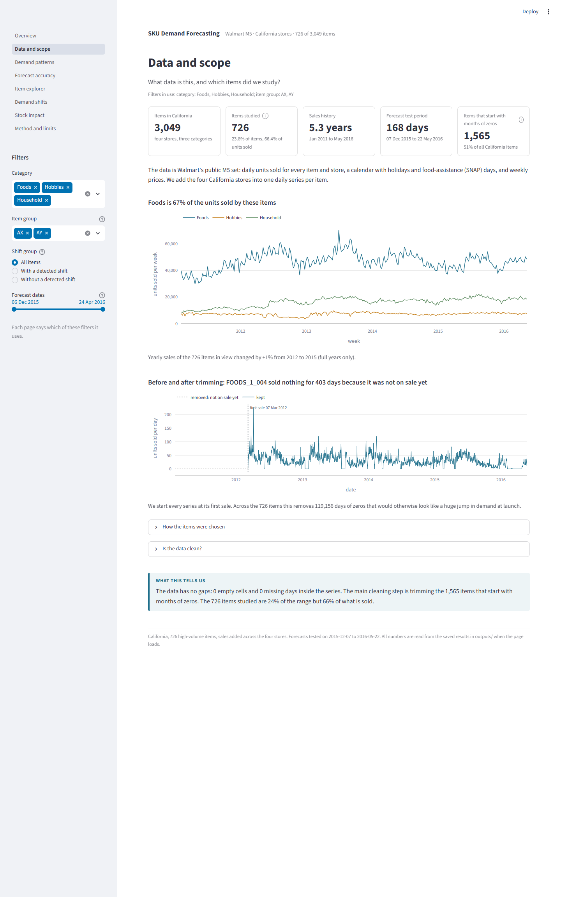
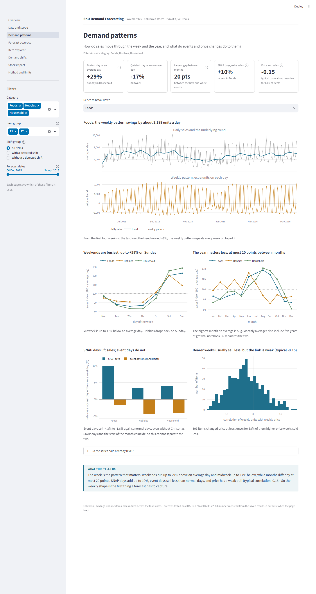
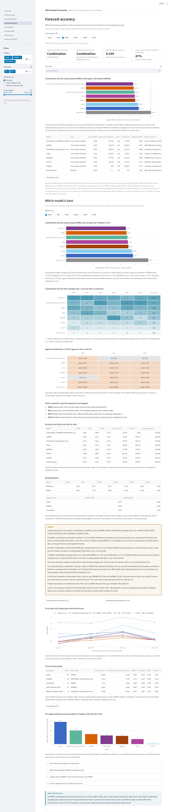
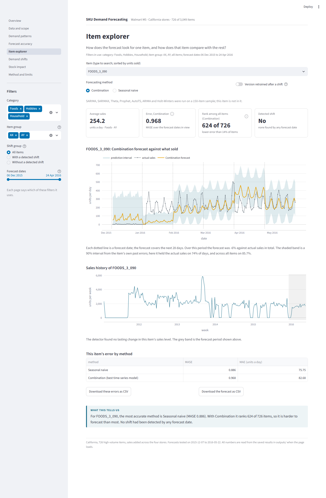
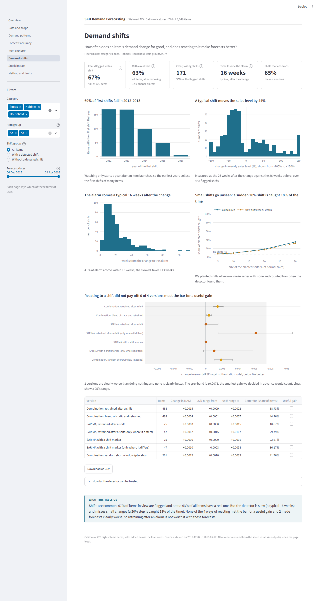
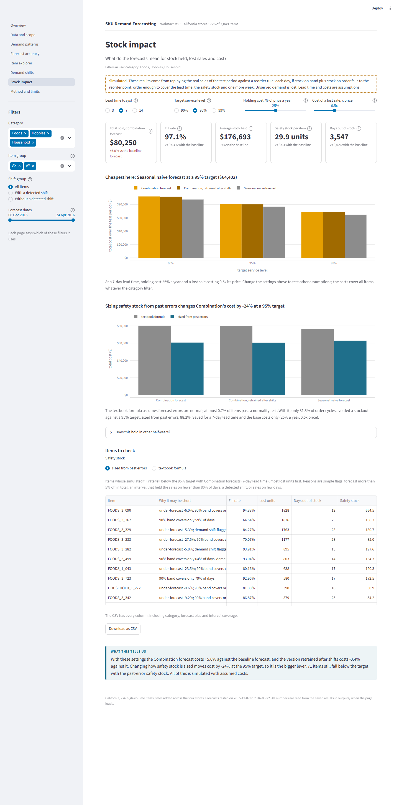
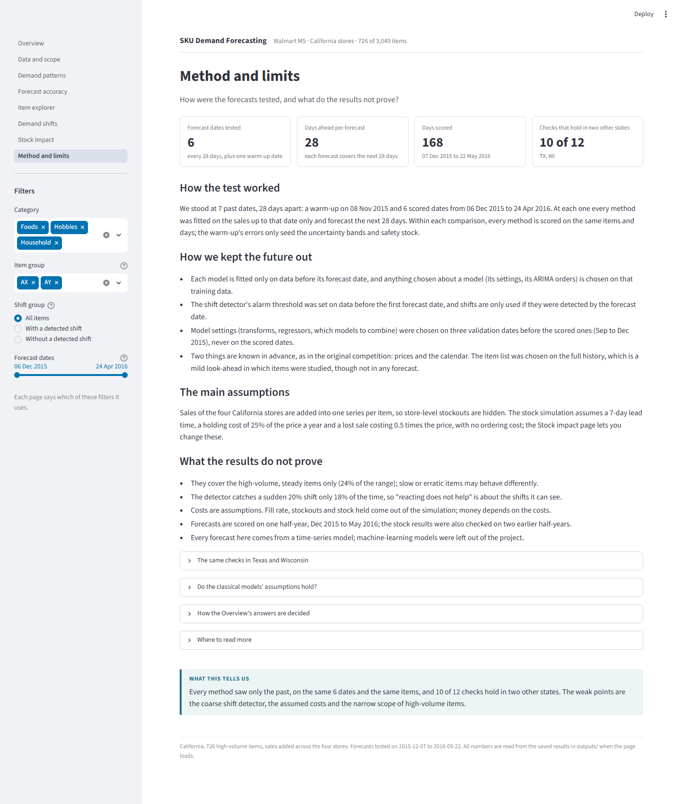

**Live demo: [sku-demand-forecasting.streamlit.app](https://sku-demand-forecasting-6skpfqcuzaiw6jrncevnkk.streamlit.app/)** (a working prototype; open the pages in the left menu).
To run it yourself: `pip install -r requirements.txt`, then `python -m streamlit run dashboard/app.py`.

# Do Sudden Changes in Demand Matter? Forecasting and Stock Planning with Walmart Data

[](../../actions/workflows/tests.yml)

A shop has to guess how much of each product it will sell, so it keeps enough on the shelf without paying for stock
that sits there. Sometimes a product's sales change for good: it gets more popular, a competitor turns up, the price
moves. We wanted to know three things. Do these lasting changes really happen, and can we spot them? If we update
the forecast after spotting one, does it get better? And what does it all mean for how much stock to keep?

We use Walmart's public M5 data: daily sales of every product in its California stores from 2011 to 2016. We model
the 726 products that sell a lot and fairly steadily, and check the main results again on Texas and Wisconsin.

<!-- FINAL:START (hand-written; the generated block below is separate) -->
## Final results

We compared 21 forecasting methods on the same test: forecast 28 days ahead, six times in a row, from December 2015 to
May 2016. The methods range from "copy last week" to classical statistics (Holt-Winters, SARIMA), machine learning
(XGBoost, LightGBM) and neural networks (LSTM, GRU, PatchTST). No method saw the test period before it was scored.
This final comparison uses a sample of 150 of the 726 products. All numbers are units sold per product per day.

| Method | Average miss (units/day) | Compared with copying last week |
|---|---|---|
| XGBoost (tuned) | 3.41 | 28% smaller miss, ranked 1st of 21 |
| Average of the top 3 | 3.49 | 2nd |
| Stack of several models | 3.46 | 3rd |
| Combination (SARIMAX, Holt-Winters, Theta) | 3.50 | 4th |
| SARIMA | 3.52 | 6th |
| Neural networks (GRU, PatchTST, LSTM) | 4.19 to 4.49 | worse than every statistical method |
| Copy last week (baseline) | 4.72 | |

What this tells us:

1. **Machine learning on a good set of features wins, but only narrowly over the classical models.** XGBoost is
   clearly better than copying last week (99% of products improve, p < 0.001). Against SARIMA and the Combination
   the gap is small and not statistically proven (p = 0.052 and 0.20), so the safe reading is that the best classical
   models and XGBoost are close.
2. **Neural networks did not pay off here.** With about five years of daily history per product, the simpler models
   were more accurate and far quicker to fit.
3. **Better stock decisions come from honest error ranges.** With a 95% target and a 7-day lead time, reordering with
   XGBoost forecasts and error ranges measured from past mistakes cost 13% less than copying last week and 40% less
   than the textbook safety-stock formula, while still filling 99% of demand.
4. **Lasting shifts in demand are real (about 63% of busy products show one), but retraining after a shift did not
   improve forecasts** for any model tried.

Storage and lost-sale costs are our assumptions, not Walmart's figures. The full tables are on the dashboard's
**Final leaderboard**, **Forecast viewer**, **Volatility (GARCH)** and **Stock impact, best model** pages.
<!-- FINAL:END -->

<!-- KEY-RESULTS:START (generated by scripts/update_readme.py; do not edit) -->
### What we found

1. Do sales levels really change? Yes, often. After removing changes that would appear just by chance, about 63% of the busy products changed their normal sales level at some point. Our change detector only notices big changes, though: a sudden 20% jump is spotted just 18% of the time.
2. Which forecast works best? Combination, ahead of SARIMA, the runner-up, for 65% of products. Its typical error is 23% smaller than simply copying last week's sales. It guesses a little low overall (1.6% under).
3. Does retraining the model after a change help? No. We tried 2 different ways. None made forecasts better, and the simplest one made them slightly worse. The same was true in Texas and Wisconsin.
4. Does a better forecast save money on stock? Partly. Using the better forecast to decide when to reorder means holding 9% less stock at 5% higher cost than the simple method, and it was clearly cheaper in 1 of 3 time periods tested. Setting safety stock from realistic error ranges cut the cost by 24%. These costs use assumed prices for storage and lost sales, not real Walmart figures.

### Classical time-series models

On a sample of 150 products, with the same backtest as above: 17% of the 726 products test as stationary (ADF and KPSS agree). SARIMA (median MASE 0.755) and Holt-Winters (0.757) against seasonal naive (0.973): SARIMA better: Yes (median difference -0.223, 95% CI -0.237 to -0.200); Holt-Winters better: Yes (-0.218, 95% CI -0.233 to -0.207). The lowest median error is Holt-Winters (damped, Box-Cox) (0.744). Reacting to a detected break helps SARIMA: No (restart +0.0000, level-shift dummy +0.0000 MASE, n = 75 products). Details: `notebooks/10_model_comparison.ipynb`.

### Time-series models

Eight time-series contenders on the same 150 products and backtest, tuned on three earlier validation dates only. The combination has the lowest median RMSE: 4.392, MAE 3.499, MAPE 58.6%, against 4.445, 3.522 and 60.3% for SARIMA as it was before tuning (significantly better on RMSE after Holm correction). Tweaks that passed validation for the SARIMA family: Fourier K=1. The combination averages SARIMAX, Holt-Winters (damped, Box-Cox), Theta. On all 726 products the winner's median MASE is 0.747; the runner-up, SARIMA, fitted on them too (09b), scores 0.755, significantly worse (smaller error for 35% of products, p < 0.001). Which gaps are real and which are ties, the ranks over six measures and the stock cost of each model: `notebooks/07i_model_verdict.ipynb`. Details: `notebooks/07h_time_series_comparison.ipynb`, `10_model_comparison.ipynb` and `docs/TS_MODELS.md`.

<details><summary>Technical details (verdicts, confidence intervals, test statistics)</summary>

| Question | Verdict | Evidence | Caveat |
|---|---|---|---|
| Do demand shifts exist, and can we detect them? | Partly (strong) | An estimated 63.5% of items have a real shift (95% CI 59.8% to 67.2%), after removing chance alarms. | The detector is coarse: a sudden 20% shift is caught only 18% of the time. |
| Which forecast is best? | Combination (strong) | Combination: median error 0.747 vs 0.976 for the simple baseline (MASE; lower is better). | It under-forecasts by 1.6% in total. |
| Does retraining after a shift help? | No (strong) | None of 2 ways of reacting improved Combination's forecasts. Simply restarting from the shift changed its error by +0.0015 MASE (n = 488 items), and the same holds in 2 other states. | Tested with Combination (restart and a blend), and on SARIMA in 08d; small shifts are invisible to the detector. |
| Does a better forecast cut stock cost? | Partly (moderate) | At a 95% target, reorder points from Combination hold 8.6% less stock at 5.0% higher cost than the simple baseline; clearly lower in 1 of 3 time windows. | Lead time and costs are assumptions, not measured data. |

- Scope: 726 high-volume (AX/AY) California products, 23.8% of 3,049 products and 66.4% of units sold.
- Shift detection: 67.8% of the 718 products with two or more years of data are flagged. The false-alarm rate on a seasonality-preserving null is 11.9%, so the chance-adjusted share with a real shift is 63.5% (95% CI 59.8% to 67.2%). Only 171 of 488 breaks are high-confidence.
- Forecasting: median MASE is 0.747 for Combination, 0.755 for SARIMA, the runner-up, and 0.976 for seasonal naive. Combination − SARIMA is -0.0074 (95% CI -0.0093 to -0.0056). Calibrated 90% bands cover 90.6% of days (was 85.7%).
- Retraining after a shift: restarting from the shift changes MASE by +0.0015 (95% CI +0.0009 to +0.0022, n = 488). None of the 2 methods tested helps.
- Inventory (95% target, 7-day lead time, assumed costs): static Combination holds 8.6% less inventory at 5.0% higher cost than seasonal naive. Calibrated safety stock changes total cost by -24.4%.
- Replication: 10 of 12 conclusion checks hold in TX and WI.

</details>
<!-- KEY-RESULTS:END -->

In short: lasting changes in sales are real and common, but reacting to them does not help, for any of the
time-series models we tried. What helps most is safety stock sized from the real spread of forecast errors rather
than a textbook formula. A better forecast, kept as it is, saves a little more in most but not all of the periods
and states we tested.

## The path through the work

The notebooks are numbered in the order you would learn the data, and each one starts by saying what question it
answers and what it hands on to the next.

| Stage | Notebook | What it does |
|---|---|---|
| 1 Meet the data | `01_dataa` | the three files, their columns and size |
| 2 Choose scope | `02_scope` | California, 3,049 products, the 726 AX/AY products we keep, and why |
| 3 Explore | `03_explore` | statistics, histograms, weekly and yearly patterns, price, SNAP days and events, data quality |
| 4 Zeros at the start | `04_zeros_and_trimming` | the months of zeros before a product's first sale, and one product decomposed before and after trimming |
| 5 Stationarity | `05_stationarity` | ADF and KPSS, differencing, what it means for the models |
| 6 Decomposition | `06_decomposition` | the weekly pattern, then the yearly one |
| 7 Classical forecasting | `07a_classical_forecasting`, `07b_classical_residuals` | seasonal naive, Holt-Winters, ARIMA and SARIMA on a rolling backtest; residual checks |
| 7 More time-series models | `07c` to `07i` | ARMA (with its AR and MA halves) and ARIMA as building blocks; the SARIMA family tuned one step at a time; VARIMA on the totals; Theta, Prophet and AutoTS; one comparison of them all; and a verdict on which is best, with ties, ranks and stock cost (`07i` runs after `11e`) |
| 8 Structural breaks | `08a` to `08d` | CUSUM and PELT, how far the detector can be trusted, and SARIMA versions that react to a break |
| 9 Best model on all products | `09_best_model_all_products`, `09b_runner_up_all_products` | the winner of 07h (the combination) on all 726 products, and two ways of retraining it after a break; the runner-up, SARIMA, on all 726 products as a check |
| 10 Comparison | `10_model_comparison` | every model in one table (classical, the eight time-series contenders, ARMA), and where the simple ones win |
| 11 Uncertainty and stock | `11a` to `11f` | honest error bands, a stock simulation, other seasons, Texas and Wisconsin |

The project reports 12 forecasting models: seasonal naive, Holt-Winters additive, Holt-Winters (damped, Box-Cox),
Theta, ARMA, ARIMA, SARIMA, SARIMAX, VARIMA (on the category totals), Prophet, AutoTS, and the combination (the plain
average of SARIMAX, the Box-Cox Holt-Winters and Theta).

`13_final_models` runs the final comparison of all 21 methods. `90_powerbi_export` and `91_dashboard_export` only
package the results for the dashboard.

## The dashboard

**Try it live: [the working prototype](https://sku-demand-forecasting-6skpfqcuzaiw6jrncevnkk.streamlit.app/).**

The dashboard is written for a retail planning manager with five minutes. It opens on a **Summary**, then has two
groups of pages:

- **Final results:** the Final leaderboard (all 21 methods on one test), a Forecast viewer for any product, Volatility
  (GARCH), and Stock impact for the best model.
- **Supporting analysis:** Overview, Data and scope, Demand patterns, Forecast accuracy, Item explorer, Demand shifts,
  Stock impact (with controls for the cost assumptions), and Method and limits.

Every number and every sentence that states a result is computed from the saved outputs when the page loads. The
filters in the sidebar keep their values from page to page. The pictures below are from the supporting pages and
switch between light and dark with your GitHub theme.

| Overview | Data and scope |
|---|---|
| <picture><source media="(prefers-color-scheme: dark)" srcset="docs/screenshots/dark/overview.png"></picture> | <picture><source media="(prefers-color-scheme: dark)" srcset="docs/screenshots/dark/data_scope.png"></picture> |
| Demand patterns | Forecast accuracy |
| <picture><source media="(prefers-color-scheme: dark)" srcset="docs/screenshots/dark/demand_patterns.png"></picture> | <picture><source media="(prefers-color-scheme: dark)" srcset="docs/screenshots/dark/accuracy.png"></picture> |
| Item explorer | Demand shifts |
| <picture><source media="(prefers-color-scheme: dark)" srcset="docs/screenshots/dark/item_explorer.png"></picture> | <picture><source media="(prefers-color-scheme: dark)" srcset="docs/screenshots/dark/demand_shifts.png"></picture> |
| Stock impact | Method and limits |
| <picture><source media="(prefers-color-scheme: dark)" srcset="docs/screenshots/dark/stock_impact.png"></picture> | <picture><source media="(prefers-color-scheme: dark)" srcset="docs/screenshots/dark/method_limits.png"></picture> |

To run it on your own computer, from the project folder with the environment active:
```bash
pip install -r requirements.txt                # first time only
python -m streamlit run dashboard/app.py
```
Then open http://localhost:8501 (add `--server.port 8502` if that port is busy) and stop it with Ctrl + C. The
dashboard only reads `outputs/`, so it needs no data download; rerun the notebooks first if you change a result.

## Run everything again
```bash
pip install -r requirements.txt     # exact package versions
pip install -r requirements-extra.txt   # AutoTS for 07f
# download the M5 data from Kaggle (M5 Forecasting - Accuracy) into data/raw/
python scripts/run_all.py           # every notebook in order, the results file, the README numbers, the tests
python scripts/run_all.py --from 07a_classical_forecasting    # or start from one notebook
```
`make all` does the same where `make` is installed.

## How we kept it honest

Every forecast only sees data up to the day it is made, and models were tuned on earlier validation dates, never on
the test period. The tests and decision rules were written down before the results, and the numbers on the dashboard
are read from the saved result files.

## Limits

We only studied high-volume products, with sales added up over the stores, so stockouts in a single store are
hidden. The 726 products were chosen by looking at their whole sales history, including the test months, so the
selection is not strictly out-of-sample. Days with zero sales are kept as zero, so some may be stockouts rather than
real lack of demand. The final comparison uses a sample of 150 products, not all 726. The break detector misses small
changes. The costs of storage and of a lost sale are our assumptions, not Walmart's figures, and the dashboard marks
every result that depends on them. The data ends in 2016, so it says nothing about shopping after COVID.

## What is in the repository
```
notebooks/   the analysis, in learning order (see the table above)
src/         shared code: break detection, forecasting, metrics, the stock simulation
dashboard/   the interactive website
scripts/     run everything, build the results file and README numbers, take screenshots
tests/       checks for the code, the results and the dashboard
outputs/     result tables, figures and results_facts.json
```
